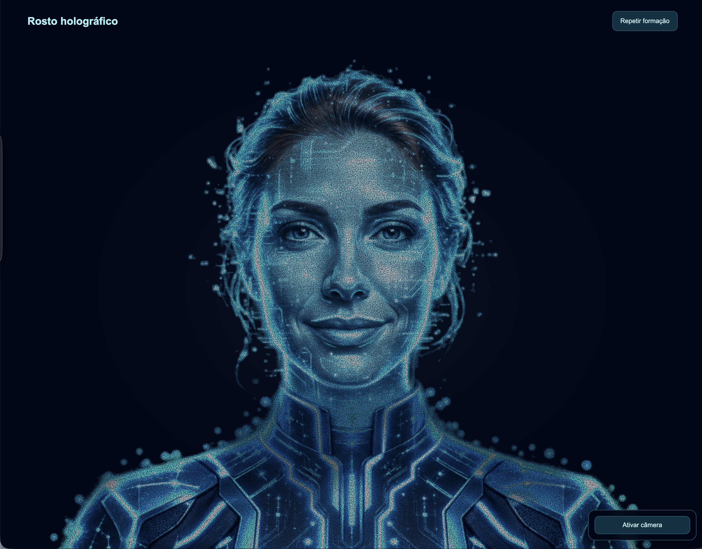

# Holograma Aria

Assistente virtual do Observatório da Indústria com rosto holográfico em partículas, desenvolvida com React, TypeScript e Three.js. A Aria acompanha expressões pela câmera e conversa por voz com o Google Gemini.

## Executar localmente

Requer Node.js 20 ou superior.

```sh
npm install
cp .env.example .env.local
npm run dev
```

Antes de iniciar, configure sua chave em `.env.local`:

```dotenv
GEMINI_API_KEY=cole_sua_chave_aqui
GEMINI_MODEL=gemini-3.6-flash
GEMINI_TTS_MODEL=gemini-3.8-flash-tts
GEMINI_VOICE=Kore
```

Abra o endereço informado no terminal. Reinicie o servidor após alterar as variáveis. Os arquivos `.env` e `.env.local` são ignorados pelo Git; `.env.example` contém somente exemplos, sem credenciais.

## Interação

- Mova o mouse para acompanhar o olhar ou ative a câmera para acompanhar seu rosto e expressões.
- Clique no holograma para sorrir e piscar. Dois cliques reproduzem as boas-vindas com voz natural e movimento da boca.
- Acene lateralmente ou movimente os dedos para a Aria dar tchau. Faça bico de beijo para ela retribuir.
- Os botões “Ativar câmera” e “Falar com a Aria” ficam agrupados na lateral, ao lado do holograma. A logo do Observatório aparece no cabeçalho.

## Conversa por voz



### Voz em tempo real

Clique em **Falar com a Aria**, permita o microfone e converse normalmente. O microfone continua ativo até clicar em **Encerrar conversa**. Faça perguntas seguidas sem clicar novamente e interrompa a resposta falando. O áudio é enviado e reproduzido em pequenos trechos, sem aguardar transcrição e geração de voz em chamadas separadas.

O modo usa `GEMINI_LIVE_MODEL=gemini-3.8-live` por padrão e a voz definida em `GEMINI_VOICE`. A chave precisa ter acesso ao modelo Live. Reinicie o servidor após mudar a configuração. Use localhost ou HTTPS para permitir o microfone.

A conversa mantém contexto durante a sessão; ao encerrar e reconectar, as últimas dez perguntas e respostas completas são recuperadas em memória. Atualizar a página apaga esse histórico. Se o serviço encerrar a conexão, clique novamente para reconectar. Não há gravação persistente no projeto.

A chave permanente fica no servidor. O navegador recebe uma credencial temporária de uso único e transmite apenas áudio diretamente ao Google, sem enviar a câmera. Saudações por detecção da câmera continuam disponíveis quando a conversa está desligada.

### Cadastro local do próprio rosto

Abra diretamente **`http://localhost:5173/cadastro`** no navegador (ou a rota **`/cadastro`** no endereço em que o projeto estiver rodando). A página principal não possui botão para o cadastro. Ative a câmera nesta página. Confira seu nome, leia e marque o consentimento, fique sozinha na câmera e clique em **Cadastrar meu rosto**. A captura usa seis amostras; olhe para a câmera e vire levemente o rosto quando solicitado. Ao terminar, clique em **Voltar para a Aria** e ative a câmera para receber a saudação pelo nome. Os cadastros existentes são compartilhados entre as duas rotas no mesmo navegador e endereço.

Somente o nome, a data do consentimento e vetores do rosto ficam no armazenamento local deste navegador. Fotos e vídeos do cadastro não são salvos nem enviados ao Google. O cadastro continua após atualizar a página e pode ser removido individualmente ou por **Excluir todos os cadastros**. Limpar os dados do site também remove os cadastros; mudar de navegador, endereço ou porta utiliza outro armazenamento.

A comparação precisa de três observações consistentes e uma margem de confiança. Em dúvida, a saudação é genérica; com várias pessoas na imagem, nenhum nome é escolhido. O cadastro deve ser feito pela própria pessoa com consentimento, não serve como autenticação e pode falhar com iluminação ou ângulo diferentes.

A saudação com o nome usa a síntese de voz do Google em `/api/speech`, com a mesma voz `GEMINI_VOICE` da conversa. O consentimento informa que o texto do cumprimento, incluindo o nome reconhecido, será enviado ao Google; imagens e vetores continuam locais. O áudio é reutilizado em memória durante a sessão para acelerar cumprimentos repetidos. Durante a geração e reprodução, o envio do microfone da conversa é pausado e retomado após a fala. Falhas são exibidas sem substituir a voz por uma voz robótica do computador.

Os modelos genéricos e a biblioteca [FaceAPI](https://github.com/vladmandic/face-api) são servidos localmente; sua licença está em `public/vision/identity/LICENSE`. Apenas os modelos de detecção, pontos faciais e comparação são carregados, sem funções de idade, gênero ou emoção. O pacote é carregado sob demanda ao ativar a câmera para comparar cadastros e oferecer o cadastro por voz.

### Cadastro pela conversa

Na página principal, ative **Ativar câmera** e **Falar com a Aria**. Se apenas a câmera estiver ligada, a saudação pergunta se a pessoa quer se cadastrar e explica que é preciso clicar em **Falar com a Aria** para ouvir sua resposta; o microfone não é ativado automaticamente. Quando uma única pessoa permanecer na câmera sem correspondência segura, a Aria primeiro pergunta se a pessoa quer se cadastrar e aguarda um sim. Só então pergunta seu nome, repete o nome entendido e pede autorização explícita para salvar o cadastro local e usar o nome na voz do Google. Responda **“sim, autorizo”** para começar a captura. Dizer somente o nome não cadastra ninguém. “Não” ou uma resposta ambígua não autoriza o cadastro.

O aplicativo controla as perguntas e usa apenas a transcrição da fala da pessoa para receber nome e autorização. Durante esse fluxo, as respostas geradas pelo modelo ficam sem reprodução para não competirem com as perguntas. A delimitação das respostas utiliza `serverContent.turnComplete`, conforme a [referência da API Live](https://ai.google.dev/api/live). O microfone fica pausado enquanto os avisos são reproduzidos e a conversa normal volta após o fluxo.

O mesmo rosto deve permanecer sozinho na câmera durante as perguntas e as seis amostras. Troca de pessoa, desaparecimento do rosto, outra pessoa na imagem, falta de resposta, câmera desligada, página oculta ou encerramento da conversa interrompem o processo sem salvar um cadastro incompleto. Também é possível usar **Cancelar cadastro**. Depois de uma recusa, a oferta não se repete enquanto a mesma pessoa permanece na câmera. Para tentar novamente imediatamente, desligue e ative a câmera. `/cadastro` continua disponível para cadastrar e excluir pessoas manualmente.

Não há limite fixo de seis pessoas. A quantidade depende do espaço de armazenamento disponível no navegador; ao atingir esse espaço, a gravação falha com um aviso e preserva os cadastros existentes. Os cadastros anteriores continuam compatíveis. O áudio dos avisos é guardado somente em memória, com até 32 mensagens recentes, sem limitar a quantidade de pessoas cadastradas.
