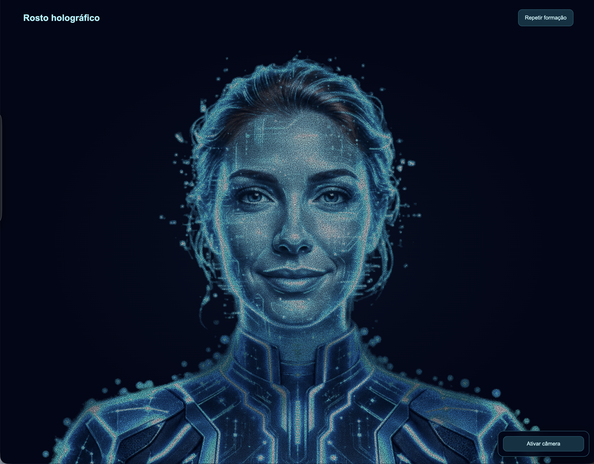

# Holograma Aria

Assistente virtual do Observatório da Indústria com rosto holográfico em partículas, desenvolvida com React, TypeScript e Three.js. A Aria acompanha expressões pela câmera e conversa por voz com o Google Gemini.

## Executar localmente

Requer Node.js 20 ou superior.

```sh
npm install
cp .env.example .env.local
npm run dev
```

Antes de iniciar, configure sua chave em `.env.local`:

```dotenv
GEMINI_API_KEY=cole_sua_chave_aqui
GEMINI_MODEL=gemini-3.6-flash
GEMINI_TTS_MODEL=gemini-3.8-flash-tts
GEMINI_VOICE=Kore
```

Abra o endereço informado no terminal. Reinicie o servidor após alterar as variáveis. Os arquivos `.env` e `.env.local` são ignorados pelo Git; `.env.example` contém somente exemplos, sem credenciais.

## Interação

- Mova o mouse para acompanhar o olhar ou ative a câmera para acompanhar seu rosto e expressões.
- Clique no holograma para sorrir e piscar. Dois cliques reproduzem as boas-vindas com voz natural e movimento da boca.
- Acene lateralmente ou movimente os dedos para a Aria dar tchau. Faça bico de beijo para ela retribuir.
- Os botões “Ativar câmera” e “Falar com a Aria” ficam agrupados na lateral, ao lado do holograma. A logo do Observatório aparece no cabeçalho.

## Conversa por voz



### Voz em tempo real

Clique em **Falar com a Aria**, permita o microfone e converse normalmente. O microfone continua ativo até clicar em **Encerrar conversa**. Faça perguntas seguidas sem clicar novamente e interrompa a resposta falando. O áudio é enviado e reproduzido em pequenos trechos, sem aguardar transcrição e geração de voz em chamadas separadas.

O modo usa `GEMINI_LIVE_MODEL=gemini-3.8-live` por padrão e a voz definida em `GEMINI_VOICE`. A chave precisa ter acesso ao modelo Live. Reinicie o servidor após mudar a configuração. Use localhost ou HTTPS para permitir o microfone.

A conversa mantém contexto durante a sessão; ao encerrar e reconectar, as últimas dez perguntas e respostas completas são recuperadas em memória. Atualizar a página apaga esse histórico. Se o serviço encerrar a conexão, clique novamente para reconectar. Não há gravação persistente no projeto.

A chave permanente fica no servidor. O navegador recebe uma credencial temporária de uso único e transmite apenas áudio diretamente ao Google, sem enviar a câmera. Saudações por detecção da câmera continuam disponíveis quando a conversa está desligada.
